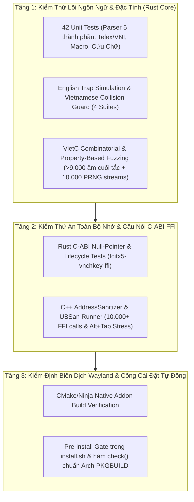

# Kiến Trúc Kiểm Thử Đa Tầng & Báo Cáo Kiểm Định Chất Lượng (Multi-Tier Testing & Verification Guide)

Tài liệu này là cẩm nang kỹ thuật dành cho các lập trình viên phát triển, bảo trì hoặc nghiên cứu kiến trúc bộ gõ **vnchKey (Tự Do Edition)**.

Khác với các bộ gõ thuần một ngôn ngữ (như extension trình duyệt viết bằng JavaScript), **vnchKey** vận hành trên kiến trúc lai 3 lớp hiệu năng cao:
1. **Lõi xử lý ngôn ngữ 100% Safe Rust** (`crates/vnchkey-core` — `#![forbid(unsafe_code)]`)
2. **Cầu nối nhị phân C-ABI FFI** (`crates/fcitx5-vnchkey-ffi` — `libfcitx5_vnchkey_ffi.so`)
3. **Module C++ Native Fcitx5 Addon** (`fcitx5-addon` — `fcitx5-vnchkey-addon.so`) giao tiếp trực tiếp với Wayland Compositor (Sway, Hyprland, KDE, GNOME).

Để bắt trọn mọi trường hợp biên (edge cases) từ ngữ âm học tiếng Việt, va chạm từ tiếng Anh, đến an toàn vùng nhớ giữa C++ và Rust, **vnchKey** áp dụng **Chiến lược Kiểm thử Đa tầng Tích hợp (3-Tier Verification Architecture)**.

---

## Sơ Đồ Kiến Trúc Kiểm Thử 3 Tầng



---

## Tầng 1: Kiểm Thử Hồi Quy, Mô Phỏng Bẫy Tiếng Anh & Property-Based Fuzzing (`vnchkey-core`)

Tầng 1 kiểm định toàn bộ thuật toán xử lý ngôn ngữ tự nhiên trong môi trường `#![forbid(unsafe_code)]`.

### 1.1. Mô phỏng tự động Bẫy Tiếng Anh vs. Bảo vệ Từ Tiếng Việt
Thay vì phỏng đoán thủ công từ tiếng Anh nào sẽ bị biến dạng khi gõ Telex, bộ kiểm thử [`crates/vnchkey-core/tests/english_trap_simulation_tests.rs`](../crates/vnchkey-core/tests/english_trap_simulation_tests.rs) bơm trực tiếp luồng phím qua `Engine::process_key()` để kiểm chứng 2 chiều:

- **Chiều 1 — Tự động khôi phục các bẫy biến dạng vô nghĩa (`test_automated_english_trap_simulation`)**:
  - Các từ kỹ thuật bị Telex làm biến dạng thành âm tiết không có trong tiếng Việt: `text` ($\to$ `tẽt`), `modern` ($\to$ `modẻn`), `exit` ($\to$ `ẽit`), `window` ($\to$ `ưindoư`), `address` ($\to$ `ađress`), `series` ($\to$ `seỉes`), `restore` ($\to$ `rétore`), `refactor` ($\to$ `rèactor`).
  - Khi nhấn `Space`, engine tự động hoàn trả 100% về từ tiếng Anh gốc.
- **Chiều 2 — Bảo vệ tuyệt đối từ Tiếng Việt có nghĩa (`test_vietnamese_collision_exceptions_protected`)**:
  - Nhiều tổ hợp phím Telex vừa trùng với từ tiếng Anh, vừa tạo thành từ tiếng Việt hoàn toàn hợp lệ và phổ biến:
    - `chaos` $\to$ **`cháo`** (*ăn cháo, cháo lòng*)
    - `reset` $\to$ **`rết`** (*con rết, rắn rết*)
    - `its` $\to$ **`ít`** (*chút ít, ít ỏi*)
    - `this` $\to$ **`thí`** (*thí sinh, thí dụ*)
    - `bus` $\to$ **`bú`** (*bú sữa*)
    - `has` $\to$ **`há`** (*há miệng*)
    - `these` $\to$ **`thế`** (*thế giới*)
    - `there` $\to$ **`thể`** (*có thể, cơ thể*)
  - Các từ này được bảo vệ trong `VIETNAMESE_COLLISION_EXCEPTIONS` để **không bao giờ bị biến ngược thành tiếng Anh** khi người dùng gõ văn bản tiếng Việt.
- **Chiều 3 — Bảo vệ khối mã Backtick & Đường dẫn (`test_backtick_inline_code_guard_and_no_autocapitalization`, `test_token_scoped_path_guard`)**:
  - Gõ `` `vnchKey` text after backtick `` giữ nguyên chữ thường sau cặp dấu backtick, không bao giờ tự ý viết hoa cưỡng chế.
  - Gõ đường dẫn `./src/engine.rs chào bạn ` chỉ khóa tiếng Anh trong phạm vi token đường dẫn và mở khóa tiếng Việt ngay lập tức sau phím cách.

### 1.2. Kiểm thử Đặc tính Ngữ âm học & Fuzzing (`vietc_regression_tests.rs`)
Tệp [`crates/vnchkey-core/tests/vietc_regression_tests.rs`](../crates/vnchkey-core/tests/vietc_regression_tests.rs) kiểm định các bất biến (invariants) của hệ thống âm vị học:

1. **Bất biến Âm cuối tắc (`test_property_based_phonotactic_invariants`)**:
   - Sinh tự động **> 9.000 tổ hợp** từ 28 phụ âm đầu $\times$ 14 nguyên âm/nhị trùng âm $\times$ 4 phụ âm cuối tắc (`-c`, `-ch`, `-p`, `-t`) $\times$ 6 phím thanh điệu bị cấm (Huyền `f`/`2`, Hỏi `r`/`3`, Ngã `x`/`4`).
   - Chứng minh đặc tính: **Không bao giờ tồn tại bất kỳ âm tiết đóng kết thúc bằng `-c, -ch, -p, -t` nào nhận thanh Huyền, Hỏi hoặc Ngã** trên cả Telex lẫn VNI.
   - *Case study thực tế*: Chính bài test đặc tính này đã phát hiện lỗi ở phiên bản cũ khi `telex.rs` đã chặn âm cuối tắc nhưng `vni.rs` lại cho phép `ac2` biến thành `àc`. Nhờ đó chốt chặn ngữ âm học đã được đồng bộ 100% sang `vni.rs`.
2. **Deterministic PRNG Fuzzing (10.000 luồng phím ngẫu nhiên)**:
   - Dùng bộ sinh số giả ngẫu nhiên LCG (`seed = 0x5DEECE66D`) bắn liên tiếp 10.000 ký tự chữ, số, dấu câu, ngoặc vuông, xuống dòng vào State Machine.
   - Đảm bảo độ ổn định tuyệt đối: **Zero Panic, Zero UTF-8 boundary corruption**.
3. **Hardcore Mixed Corpus (`test_mixed_casing_and_phonology_violations`)**:
   - Kiểm tra các biến thể lập trình phức tạp (`TEXT`, `mIxEd`, `lUxUrY`, `useState`, `loWeRcAsE`, `$mixed_CORPUS`) cùng với địa danh Tây Nguyên và phương ngữ Nam Bộ (`D9a8k1 La8k1` / `Ddawks Lawks` $\to$ `Đắk Lắk`, `quon73` / `quonwr` $\to$ `quởn`).

---

## Tầng 2: Kiểm Thử Ranh Giới C-ABI FFI & Quét Rò Rỉ Bộ Nhớ (ASan + UBSan)

Do `fcitx5-vnchkey-ffi` xuất các hàm `extern "C"` cho tiến trình C++ Fcitx5 gọi trực tiếp, bất kỳ lỗi con trỏ `NULL`, giải phóng hai lần (`double free`) hay rò rỉ chuỗi (`memory leak`) nào cũng có thể làm sập Fcitx5 Server trên Wayland.

### 2.1. Kiểm thử C-ABI nội bộ bằng Rust (`crates/fcitx5-vnchkey-ffi/src/lib.rs`)
- **`test_ffi_null_pointer_safety`**: Truyền `std::ptr::null_mut()` vào toàn bộ các hàm FFI (`fcitx5_vnchkey_process_key`, `fcitx5_vnchkey_rescue_sentence`, `fcitx5_vnchkey_apply_accent_to_selection`, `fcitx5_vnchkey_free_string`, `fcitx5_vnchkey_free`...) để chứng minh mọi hàm đều có guard bảo vệ an toàn.
- **`test_ffi_full_lifecycle_and_memory_management`**: Kiểm tra chu trình cấp phát `CString::into_raw()` từ Rust và thu hồi qua `fcitx5_vnchkey_free_string()` cho toàn bộ tính năng: gõ Telex, Cứu Chữ (`rescue_sentence`), Cứu Dấu (`apply_accent_to_selection`).
- **`test_ffi_rapid_focus_switch_stress`**: Mô phỏng 5.000 lần chuyển tiêu điểm cửa sổ (`Alt+Tab`) ngay khi đang gõ dở âm tiết.

### 2.2. Kiểm thử C++ AddressSanitizer & UndefinedBehaviorSanitizer (`fcitx5-addon/tests/ffi_asan_test.cpp`)
Tệp [`fcitx5-addon/tests/ffi_asan_test.cpp`](../fcitx5-addon/tests/ffi_asan_test.cpp) là một trình kiểm thử độc lập bằng C++ được biên dịch với cờ `-fsanitize=address,undefined` của GCC/Clang và liên kết động trực tiếp vào `libfcitx5_vnchkey_ffi.so`:
- Thực thi mô phỏng gõ tiếng Việt đa byte UTF-8 (`Tiếng Việt`, `Đắk Lắk`), Cứu Chữ, Cứu Dấu, chuyển đổi bảng mã Unicode Dựng Sẵn (NFC) $\leftrightarrow$ Unicode Tổ Hợp (NFD).
- Chạy vòng lặp **10.000 chu kỳ cấp phát chuỗi & reset liên tục**.
- Khi kết thúc chương trình, bộ dò **LeakSanitizer (LSan)** của GCC/Clang quét toàn bộ heap của tiến trình để xác nhận **0 bytes leaked** và **0 undefined behaviors**.

---

## Tầng 3: Kiểm Định Biên Dịch Wayland & Cổng Bảo Vệ Cài Đặt

Để đảm bảo không một bản build lỗi nào có thể lọt vào hệ thống `/usr` của người dùng:
1. **Trong [`PKGBUILD`](../PKGBUILD)**: Đã tích hợp hàm `check()` chuẩn của Arch Linux / Manjaro. Khi chạy `makepkg -C -si`, trình đóng gói tự động thực thi `cargo test --release --workspace` trước khi đóng gói `.pkg.tar.zst`.
2. **Trong [`install.sh`](../install.sh)**: Bước `1/5` tự động chạy toàn bộ test suite. Nếu bất kỳ bài kiểm thử nào thất bại (`set -e`), quá trình cài đặt sẽ dừng lại ngay lập tức trước khi chạm vào `/usr/lib`.

---

## Hướng Dẫn Chạy Kiểm Thử Cho Lập Trình Viên

### Cách 1: Chạy toàn bộ 3 tầng kiểm định chỉ với 1 lệnh (Khuyên dùng)
Dự án cung cấp sẵn script tự động hóa [`scripts/verify-release.sh`](../scripts/verify-release.sh):

```bash
./scripts/verify-release.sh
```

**Kết quả chuẩn khi chạy thành công:**
```text
══════════════════════════════════════════════════════════════════════
  vnchKey: MULTI-LANGUAGE INTEGRATION & ASAN VERIFICATION SUITE       
══════════════════════════════════════════════════════════════════════

==> [Tầng 1/3] Kiểm thử Hồi quy, Bẫy Tiếng Anh & Property-Based Fuzzing (Rust Core)...
     Running unittests src/lib.rs (fcitx5_vnchkey_ffi) ... 3 passed
     Running unittests src/main.rs (fcitx5_vnchkey_settings) ... 1 passed
     Running unittests src/lib.rs (vnchkey_core) ... 42 passed
     Running tests/english_trap_simulation_tests.rs ... 4 passed
     Running tests/vietc_regression_tests.rs ... 6 passed

==> [Tầng 2/3] Kiểm thử Rò rỉ Bộ nhớ & Ranh giới C-ABI FFI (GCC/Clang ASan + UBSan)...
[ASan/UBSan] Starting C++ <-> Rust FFI Boundary Sanity Suite...
[ASan/UBSan] PASSED: 0 memory leaks, 0 undefined behaviors across 10,000+ FFI calls!

==> [Tầng 3/3] Kiểm thử Biên dịch Fcitx5 C++ Addon trên Wayland/Linux...
[100%] Built target fcitx5-vnchkey-addon

══════════════════════════════════════════════════════════════════════
✔ TOÀN BỘ 3 TẦNG KIỂM ĐỊNH ĐẠT 100% (ZERO WARNINGS, ZERO MEMORY LEAKS)
══════════════════════════════════════════════════════════════════════
```

### Cách 2: Chạy riêng từng phần khi đang phát triển tính năng mới

```bash
# 1. Chỉ chạy kiểm thử bẫy tiếng Anh & bảo vệ từ va chạm tiếng Việt:
cargo test --test english_trap_simulation_tests

# 2. Chỉ chạy kiểm thử VietC, Tây Nguyên & Property-Based Fuzzing:
cargo test --test vietc_regression_tests

# 3. Chạy kiểm thử trực tiếp Headless Engine (Cú pháp code, từ khóa ngắn as/for/in, và ngữ cảnh thực tế):
cargo run --example test_headless -p vnchkey-core

# 4. Chỉ chạy kiểm thử cầu nối C-ABI FFI bằng Rust:
cargo test -p fcitx5-vnchkey-ffi

# 5. Biên dịch và chạy riêng bài test C++ AddressSanitizer:
cargo build -p fcitx5-vnchkey-ffi
g++ -O1 -g -fsanitize=address,undefined fcitx5-addon/tests/ffi_asan_test.cpp \
    -L target/debug -lfcitx5_vnchkey_ffi -Wl,-rpath,"$PWD/target/debug" \
    -o /tmp/ffi_asan_test && /tmp/ffi_asan_test
```

---

## 4. Kiểm Thử Trực Tiếp Thuật Toán Không Phụ Thuộc GUI (Headless Runner)

Khi kiểm thử độ nhạy của bộ gõ trong môi trường lập trình hoặc trên hệ thống Wayland thuần (Sway, Hyprland), các script giả lập bàn phím GUI bên thứ ba (như `pyautogui`, `xdotool`) thường bị chặn hoặc gặp vấn đề đọc clipboard giữa các sandbox.

Dự án cung cấp bộ chạy kiểm thử trực tiếp qua lõi Engine Rust:
- **Tệp mã nguồn**: [`crates/vnchkey-core/examples/test_headless.rs`](../crates/vnchkey-core/examples/test_headless.rs)
- **Lệnh thực thi**:
  ```bash
  cargo run --example test_headless -p vnchkey-core
  ```
- **Phạm vi kiểm thử**:
  1. Cú pháp lập trình chứa từ khóa tiếng Anh ngắn 2 ký tự: `const as = true;`, `if (x in list) return;`, `for (let i = 0; i < 10; i++)`, `let false = !true;`, `import { useState } from 'react';`.
  2. Tự động nhận diện từ khóa bypass tiếng Anh không bị biến dạng khi kết thúc từ bằng dấu cách, dấu chấm phẩy, hoặc ngoặc đơn.
  3. Xử lý câu hỗn hợp tiếng Việt có phím Telex chuẩn kết hợp thuật ngữ công nghệ tiếng Anh (`Docker`, `MySQL`, `console`, `database`, `DOM observer`, `repo vnchKey`).

---

## Bảng Tổng Hợp Kết Quả Kiểm Định Hiện Tại (v0.3.2 Readiness)

| Hạng mục kiểm định | Công cụ / Tệp kiểm thử | Quy mô / Số lượng | Trạng thái |
| :--- | :--- | :--- | :---: |
| **Unit Tests Lõi Ngôn Ngữ** | `crates/vnchkey-core/src/lib.rs` | 42 unit tests | **PASS 100%** |
| **Mô phỏng Bẫy Tiếng Anh & Bảo vệ Va chạm** | `english_trap_simulation_tests.rs` | 4 test suites (35+ kịch bản) | **PASS 100%** |
| **VietC Regression & Property-Based Fuzzing** | `vietc_regression_tests.rs` | 6 test suites (>9.000 tổ hợp âm tắc + 10.000 PRNG) | **PASS 100%** |
| **Cầu nối C-ABI FFI (Rust side)** | `crates/fcitx5-vnchkey-ffi/src/lib.rs` | 3 test suites (Null safety + 5.000 resets) | **PASS 100%** |
| **C++ AddressSanitizer & UBSan (FFI Boundary)** | `fcitx5-addon/tests/ffi_asan_test.cpp` | >10.000 FFI calls (LSan heap check) | **0 Bytes Leaked** |
| **Settings GUI Deduplication** | `crates/vnchkey-settings/src/config.rs` | 1 unit test | **PASS 100%** |
| **An toàn Mã nguồn Lõi (`vnchkey-core`)** | `#![forbid(unsafe_code)]` | Toàn bộ crate lõi | **100% Safe Rust** |

